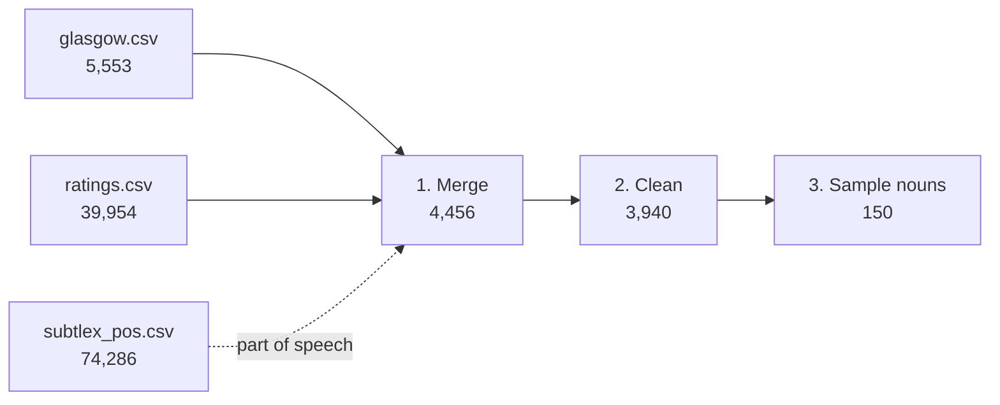

# Word Dataset

`build_dataset.py` builds the word stimuli for studying how a word's **imageability** relates to whether people can recognize the drawing generated for it.

It produces two word lists:

| Output | Rows | What it is |
| --- | --- | --- |
| `processed/cleaned_words.csv` | 3,940 | Every word that is in both norm datasets and passes cleaning. All norm columns plus part of speech. Use this to draw new samples or for analysis. |
| `processed/sampled_words.csv` | 150 | **The experiment stimuli**: 50 nouns each with low, medium, and high imageability. |
| `processed/build_report.json` | — | Record of the build: counts at every step, what each cleaning rule removed (with examples), and all parameters. |

## Quick start

Requires Python 3 with pandas (built with pandas 3.0.2).

```bash
python3 dataset/build_dataset.py
```

Rerunning with the same inputs and parameters reproduces identical files.

## Sources (`raw/`)

| File | Source | Rows | Used for |
| --- | --- | --- | --- |
| `glasgow.csv` | Glasgow Norms (Scott et al., 2019) | 5,553 | Imageability (the grouping score) and 8 other rated dimensions |
| `ratings.csv` | Brysbaert, Warriner & Kuperman (2014) concreteness norms | 39,954 | How widely known a word is (`Percent_known`) and its frequency (`SUBTLEX`) |
| `subtlex_pos.csv` | SUBTLEX-US with part of speech (Brysbaert, New & Keuleers, 2012) | 74,286 | Each word's dominant part of speech |

`subtlex_pos.csv` was converted from `SUBTLEX-US frequency list with PoS and Zipf information.xlsx` ([OSF](https://osf.io/djpqz/files), CC BY-NC-SA 4.0), keeping `Word`, `FREQcount`, `Dom_PoS_SUBTLEX`, `Percentage_dom_PoS`, `All_PoS_SUBTLEX`, and `All_freqs_SUBTLEX`. Its `FREQcount` equals `SUBTLEX` in `ratings.csv` for every cleaned word.

## Pipeline



### 1. Merge

Words are lowercased and trimmed, then Glasgow and the ratings are inner-joined on the word, giving **4,456** words. Each word's dominant part of speech from SUBTLEX-US is attached (all 3,940 cleaned words have one).

Glasgow's sense-specific rows such as `bark (dog)` have no counterpart in the ratings, so they do not join; they are used in the next step to find ambiguous words.

### 2. Clean

Rules are applied in this order; each word is counted under the first rule that removes it.

| Rule | Removes | Count | Examples |
| --- | --- | --- | --- |
| `not_single_word` | Anything other than one alphabetic word (spaces, hyphens, punctuation, `Bigram != 0`) | 1 | yo-yo |
| `ambiguous` | Words Glasgow rates separately per sense, e.g. `bark (dog)` / `bark (tree)`. A drawing of such a word could show either meaning. | 367 | address, aim, apple, arm, ball, band, bark, seal |
| `not_well_known` | `Percent_known < 0.9`: under 90% of raters knew the word | 41 | adage, baroque, bassoon, bugle, chasm |
| `too_rare` | `SUBTLEX < 10`: fewer than 10 occurrences in the 51-million-word SUBTLEX-US subtitle corpus (a raw count, not per million) | 67 | abbreviate, abdicate, analogue, cacti |
| `vulgar` | Profanity, insults, sexual terms, sexual anatomy, sexual violence, and crude bodily words listed in `vulgar_words.txt` | 40 | fucker, intercourse, orgasm, obscenity |
| `outside_bins` | Imageability outside the bin range (1–7) | 0 | — |

**3,940** words remain. `build_report.json` lists the removal counts and examples from the latest build.

### 3. Sample

The cleaned words are grouped by Glasgow imageability (1–7 scale), and 50 **nouns** are drawn at random from each group (seed `42`):

| Group | Imageability | Cleaned words | Nouns available | Sampled |
| --- | --- | --- | --- | --- |
| Low | `[1, 3]` | 517 | 214 | 50 |
| Medium | `(3, 5]` | 1,769 | 860 | 50 |
| High | `(5, 7]` | 1,654 | 1,402 | 50 |

Only nouns are sampled because part of speech is tied to imageability: low-imageability words are mostly adjectives and verbs, high-imageability words mostly nouns. Keeping one part of speech stops it from confounding the comparison and lets every word use the same prompt template.

Example sampled words:

- **Low:** aptitude, chance, instinct, value, wisdom
- **Medium:** amount, beauty, health, signal, trade
- **High:** crocodile, notebook, phone, pineapple, scientist

## Output columns

Both CSVs have the same columns, one row per word.

| Columns | Meaning |
| --- | --- |
| `word` | Lowercased word |
| `length` | Number of letters (Glasgow) |
| `glasgow_<dimension>_mean`, `_sd`, `_n` | Glasgow rating mean, standard deviation, and number of raters. Dimensions: `arousal`, `valence`, `dominance` (1–9); `concreteness`, `imageability`, `familiarity`, `aoa` (age of acquisition), `semantic_size`, `gender` (1–7) |
| `Bigram` | 1 if the ratings entry is a two-word expression (always 0 after cleaning) |
| `ratings_concreteness_mean`, `_sd` | Brysbaert concreteness (1–5) |
| `Unknown`, `Total`, `Percent_known` | Raters who did not know the word, total raters, and the share who knew it |
| `SUBTLEX` | Raw frequency count in SUBTLEX-US |
| `pos` | Dominant part of speech in SUBTLEX-US (`Noun`, `Verb`, `Adjective`, `Name`, ...) |
| `pos_share` | Share of the word's occurrences that use the dominant part of speech |
| `score_bin` | Imageability group: `[1, 3]`, `(3, 5]`, or `(5, 7]` |

## Options

| Option | Default | Meaning |
| --- | --- | --- |
| `--glasgow`, `--ratings`, `--pos` | files in `raw/` | Input files |
| `--vulgar-words` | `vulgar_words.txt` | Word list removed by the `vulgar` rule |
| `--output-dir` | `processed/` | Where outputs are written |
| `--min-known` | `0.9` | Minimum `Percent_known` |
| `--min-subtlex` | `10` | Minimum `SUBTLEX` count |
| `--bin-edges` | `1 3 5 7` | Imageability group boundaries |
| `--per-bin` | `50` | Words sampled per group |
| `--sample-pos` | `Noun` | Part of speech to sample |
| `--seed` | `42` | Random seed |


### Changing parameters

Pass options on the command line rather than editing the code, for example:

```bash
python3 dataset/build_dataset.py --seed 7 --output-dir dataset/processed/seed7
```

`--seed` controls random sampling. The same seed produces the same 150 words, while different seeds produce different samples under the same rules.

The committed `sampled_words.csv` is the official stimulus list generated with the default settings. Save experimental samples to a different `--output-dir`. If the defaults change, regenerate `sampled_words.csv`.

Two settings must be changed manually:

- `vulgar_words.txt`: Edit the list of excluded words.
- `SCORE` in `build_dataset.py`: Select a different Glasgow dimension for grouping. This changes the study design.


## Notes and limitations

- **Part of speech comes from subtitles and can be imperfect.** Only words tagged `Noun` are sampled. Words tagged `Name` are excluded even when they are common nouns (e.g. armadillo, buffalo), because the tag also covers surnames such as baker or brown. A few tags are surprising (e.g. `dopey` is tagged `Noun`).
- **The ambiguity rule is strict.** It removes every word Glasgow rates by sense, including words with one dominant meaning such as `apple` (Glasgow also rates `Apple (brand)`).
- **The vulgar-word list is hand-curated.** It was built by checking the cleaned words against the [LDNOOBW](https://github.com/LDNOOBW/List-of-Dirty-Naughty-Obscene-and-Otherwise-Bad-Words) English list (CC BY 4.0) and searching word stems, then reviewing by hand. Borderline words such as `breast`, `naked`, `mistress`, and `seduction` are kept, as are negative but not vulgar words such as `killer` or `heroin`. Edit `vulgar_words.txt` and rerun to change it.
- `sampled_words.csv` is the fixed stimulus list and is tracked in Git. `cleaned_words.csv` and `build_report.json` are regenerated by the script.

## References

- Brysbaert, M., New, B., & Keuleers, E. (2012). Adding part-of-speech information to the SUBTLEX-US word frequencies. *Behavior Research Methods, 44*(4), 991–997.
- Brysbaert, M., Warriner, A. B., & Kuperman, V. (2014). Concreteness ratings for 40 thousand generally known English word lemmas. *Behavior Research Methods, 46*(3), 904–911.
- Scott, G. G., Keitel, A., Becirspahic, M., Yao, B., & Sereno, S. C. (2019). The Glasgow Norms: Ratings of 5,500 words on nine scales. *Behavior Research Methods, 51*(3), 1258–1270.
